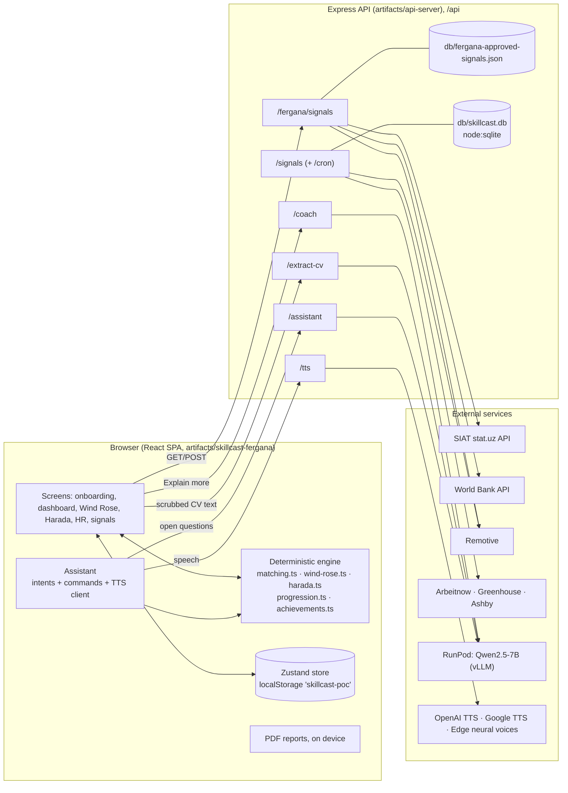
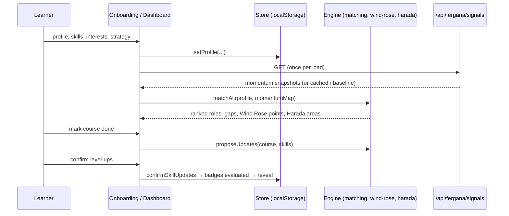
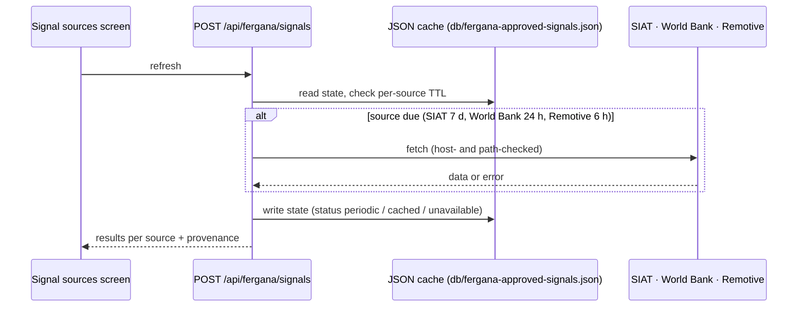
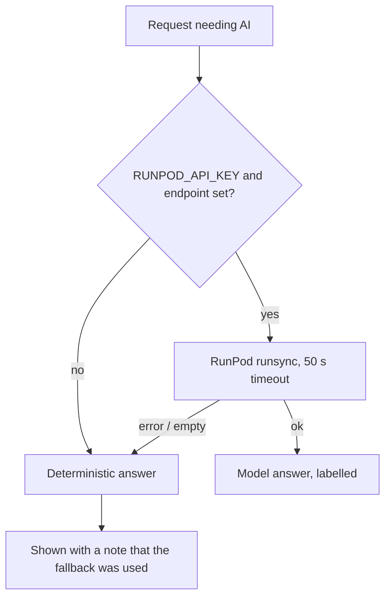

# 3. Technical architecture

## 3.1 System overview

SkillCast is a **local-first single-page app** with a small, stateless-for-users **Express API**. All user data
(profile, skills, progress, badges, employer setup) lives in the browser. The API only serves public market signals and
optional AI helpers, and it never stores anything about a user.



The original SkillCast app (`artifacts/skillcast`, served at `/skillcast/`) uses the `/signals` pipeline; SkillCast
Fergana uses `/fergana/signals`. Both share the momentum formula in `momentum.ts`.

## 3.2 Workspace structure

pnpm workspaces (`pnpm-workspace.yaml`), TypeScript project references (`tsconfig.json`, `tsconfig.base.json`).

```
.
├── artifacts/
│   ├── skillcast-fergana/        # The product: React 19 + Vite + Tailwind 4 SPA
│   │   ├── index.html            # Metadata, icons, fonts
│   │   ├── vite.config.ts        # Requires PORT and BASE_PATH; CSP (dev header / prod meta)
│   │   ├── public/               # favicon.svg/.ico, PWA icons, site.webmanifest, fonts, catalog/extra.json
│   │   ├── src/
│   │   │   ├── App.tsx           # ThemeProvider (default light), TooltipProvider, Toaster
│   │   │   ├── app/page.tsx      # Shell: header, views by store.view, assistant, a11y panel, RouteSync
│   │   │   ├── components/skillcast/   # ~40 feature components (see 02-features.md)
│   │   │   ├── components/ui/    # shadcn/ui primitives (Radix)
│   │   │   ├── data/             # roles (16), skills (50), courses (23), occupations (131), sources (26), team, institution
│   │   │   └── lib/              # engine, store, i18n (EN/UZ/RU copy tables + uz-cyrl converter), voice, PDF
│   │   └── tests/                # Bun unit/integration tests + Playwright e2e script
│   ├── api-server/               # Express 5 API, bundled with esbuild (build.mjs)
│   │   ├── src/app.ts, index.ts  # Middleware, /api router, PORT/HOST
│   │   ├── src/routes/           # health, skillcast (signals, coach, extract-cv), fergana-signals, assistant (tts, assistant)
│   │   ├── src/skillcast/lib/    # momentum, signals-run, fergana-signals, db (node:sqlite), runpod, assistant, tts
│   │   ├── src/skillcast/data/   # server copies of roles, skills (40), curated research priors
│   │   └── prepare-db.mjs        # Creates db/ before start
│   ├── skillcast/                # Original SkillCast app (reference), served at /skillcast/
│   └── mockup-sandbox/           # Replit design canvas for UI mockups (not part of the product)
├── lib/
│   ├── api-spec/                 # openapi.yaml + orval.config.ts (source of truth for generated code)
│   ├── api-zod/                  # Generated Zod schemas (used by the API for validation)
│   ├── api-client-react/         # Generated React Query client (types used by the frontend)
│   └── db/                       # Drizzle + PostgreSQL scaffold: declared, NOT used (no tables, no imports)
├── scripts/                      # dev.mjs (one-command local dev), dev-lib + tests, preinstall, post-merge.sh
├── docs/                         # This documentation
├── .replit, artifacts/*/.replit-artifact/artifact.toml   # Replit workflows and deployment
└── .migration-backup/            # Reference copy of the original import; excluded from deployment
```

| Package | Name | Role |
| --- | --- | --- |
| `artifacts/skillcast-fergana` | `@workspace/skillcast-fergana` | Product frontend |
| `artifacts/api-server` | `@workspace/api-server` | Shared API for both apps |
| `artifacts/skillcast` | `@workspace/skillcast` | Original app, preserved |
| `artifacts/mockup-sandbox` | `@workspace/mockup-sandbox` | Design canvas (Replit "Canvas" artifact) |
| `lib/api-spec` | `@workspace/api-spec` | OpenAPI contract and codegen |
| `lib/api-zod` | `@workspace/api-zod` | Generated validation schemas |
| `lib/api-client-react` | `@workspace/api-client-react` | Generated client and types |
| `lib/db` | `@workspace/db` | Unused PostgreSQL scaffold (throws without `DATABASE_URL` if imported) |
| `scripts` | `@workspace/scripts` | Dev tooling |

## 3.3 Frontend architecture

- **Rendering**: React 19, client-only (`app/page.tsx` waits for mount before rendering views, to avoid hydration mismatches
  with `localStorage`).
- **State**: one Zustand store (`src/lib/store.ts`) persisted to `localStorage` key `skillcast-poc`. `partialize` chooses
  what is saved; `merge` validates and normalises every saved field before first render (unknown roles, malformed
  skills and bad dates are dropped). Session-only UI state (assistant and accessibility panels) lives in
  `src/lib/ui-panels.ts`.
- **Navigation**: `store.view` + `store.dashTab`, mirrored to the URL hash by `route-sync.tsx`.
- **Engine** (pure functions, unit-tested): `matching.ts` (match score), `wind-rose.ts` (spokes and gaps), `harada.ts`
  (roadmap), `progression.ts` (course → level-ups and revert), `achievements.ts` (badge rules), `learning-rank.ts` and
  `resource-match.ts` (where to learn), `cv.ts` (PII scrubber and extractor).
- **Signals**: `SignalsProvider` in `components/skillcast/shared.tsx` loads `GET /api/fergana/signals` once (30 s timeout),
  exposes `momentumMap`, and refreshes with `POST`. Skills without a snapshot use their `seedMomentum` baseline,
  labelled in the UI.
- **i18n**: `src/lib/i18n.ts` builds dictionaries from several copy tables (`*-i18n.ts`, `i18n-uz.ts`, `i18n-inline.ts`).
  Later tables override earlier ones (`polish-i18n.ts` is applied last). Uzbek Cyrillic is generated from Uzbek Latin by
  `uz-cyrillic.ts`, which keeps brand names, acronyms, URLs and placeholders. `makeT(lang)` **throws** on a missing key,
  so missing translations fail fast in tests. In Uzbek, "SDG" becomes "BRM".
- **Theming**: `next-themes` with `attribute="class"`, default `light`, no system detection; Tailwind `dark:` variants
  plus CSS variables in `src/app/globals.css`.
- **Charts**: Recharts (Wind Rose radar, bar charts); PDF via jsPDF on the device with an embedded DejaVu Sans subset.

## 3.4 API reference

Base path `/api`. JSON in and out unless stated. Validation uses Zod (`@workspace/api-zod` or local schemas). No
authentication except the cron route.

| Method | Path | Purpose | Used by | Documented in OpenAPI |
| --- | --- | --- | --- | --- |
| GET | `/healthz` | `{"status":"ok"}` | dev script, monitoring | yes |
| GET | `/fergana/signals` | Fergana evidence + momentum snapshots (cached) | SkillCast Fergana | yes |
| POST | `/fergana/signals` | Ask the sources for fresh data (rate-limited per source) | Fergana "Refresh live sources" | **no** |
| GET | `/signals` | Latest momentum snapshot run (SQLite), rebuilt if older than 6 h | Original app | yes |
| POST | `/signals` | Force refresh (60 s cooldown) | Original app | yes |
| GET | `/signals/cron` | Scheduled ingest; `Authorization: Bearer $CRON_SECRET`; 501 if unset | scheduler | yes |
| POST | `/coach` | Narrate a match or Harada plan from scores and gaps | Assistant "Explain in more detail" | yes |
| POST | `/extract-cv` | Skill proposals from **scrubbed** CV text | CV step | yes |
| POST | `/assistant` | LLM answer to an open question with a compact context; may return allow-listed UI actions | Assistant | **no** |
| POST | `/tts` | Speech audio (`audio/mpeg`) for an answer | Assistant | **no** |

### Examples

```bash
# Health
curl -s http://localhost:8080/api/healthz
# {"status":"ok"}

# Fergana signals (abridged real response)
curl -s http://localhost:8080/api/fergana/signals
# {"runId":"fergana-2026-11-22T13:26:58.604Z","live":false,"totalPostings":16,"confidence":"low",
#  "sources":[…],"snapshots":[{"skillSlug":"prompt-engineering","postings":5,"recentPostings":5,
#  "earlierPostings":0,"frequency":31.25,"trend":100,"momentum":98}, … 40 skills],
#  "changelog":[…],"provenance":{"mode":"…","calculatedAt":"…","refreshLimited":…,"skillSourceIds":[…],"sources":[…]}}

# Coach narration (deterministic template when RunPod is not configured)
curl -s -X POST http://localhost:8080/api/coach -H 'content-type: application/json' \
  -d '{"roleSlug":"data-analyst","score":60,"factors":[{"label":"Skills","value":0.5}],"gap":[],"scenario":"moderate","lang":"en"}'
# {"narration":"Match 60/100, driven mainly by skills (50%). …","model":"deterministic template (LLM unavailable)","fallback":true}

# Speech
curl -s -X POST http://localhost:8080/api/tts -H 'content-type: application/json' \
  -d '{"text":"Salom!","lang":"uz"}' -o answer.mp3
# Headers: Content-Type: audio/mpeg, X-TTS-Provider: edge|openai|google, X-TTS-Voice: uz-UZ-MadinaNeural

# Assistant (503 + {"fallback":true} without RunPod; the browser then answers deterministically)
curl -s -X POST http://localhost:8080/api/assistant -H 'content-type: application/json' \
  -d '{"lang":"en","message":"What should I learn next?","context":{"tab":"overview","gaps":["Data analysis"]}}'
```

Request limits (from the Zod schemas): `/tts` text ≤ 1,500 characters, `lang` ∈ `uz | ru | en`; `/assistant` message ≤ 600
characters, history ≤ 8 turns, screen summary ≤ 1,200 characters; `/extract-cv` text 40–20,000 characters.

> **Known contract bug:** `/coach` accepts `lang` ∈ `en | ms | zh | ru` (left over from the original Malaysian app), but
> the Fergana frontend sends the interface language. Uzbek (the default) and Uzbek Cyrillic get **HTTP 400**, so
> "Explain in more detail (AI)" always shows an error for them (verified with `curl`). Fix: change the enum in
> `lib/api-spec/openapi.yaml` to `en | uz | ru` (map `uz-cyrl` to `uz` in the client), regenerate with
> `pnpm --filter @workspace/api-spec run codegen`, and add "Reply in Uzbek." to `languageInstruction` in
> `artifacts/api-server/src/routes/skillcast.ts`.

## 3.5 Data flows

### Learner forecast (no network required except signals)



### Signals refresh



### AI with deterministic fallback



## 3.6 Storage

| Where | What | Lifetime |
| --- | --- | --- |
| Browser `localStorage` `skillcast-poc` | Language, profile, skills, chosen role, courses, skill-update log, Harada statuses, badges, study days, reflections, learning paths, employer and institution setup, accessibility and voice settings, demo flag | Until the user resets or clears site data |
| Browser `localStorage` `theme` | Explicit light/dark choice | Same |
| Browser `localStorage` `skillcast-pre-demo` | The learner's own state while the demo profile is shown | Until "Leave demo" |
| API `db/fergana-approved-signals.json` | Fergana source states, observations, snapshots, history | Rebuildable cache |
| API `db/skillcast.db` (SQLite via `node:sqlite`) | `SignalRun`, `SignalSnapshot`, `ChangelogEntry` for the `/signals` pipeline; runs kept 7 days | Rebuildable cache |

SQLite schema (`artifacts/api-server/src/skillcast/lib/db.ts`, `SCHEMA_SQL`):

```sql
SignalRun(id PK, createdAt, live, totalPostings, sources, note)
SignalSnapshot(id PK, runId FK→SignalRun ON DELETE CASCADE, skillSlug, postings, recentPostings,
               earlierPostings, frequency, trend, momentum, samples JSONB, createdAt; UNIQUE(runId, skillSlug))
ChangelogEntry(id PK, createdAt, version, live, summary, details)
```

Neither cache is durable across Replit republishes or serverless instances, and neither holds personal data. There is
**no user database**. `lib/db` (Drizzle/PostgreSQL) is an empty scaffold and is the natural place for future accounts
(see [08-telegram-ecosystem.md](08-telegram-ecosystem.md)).

## 3.7 AI integrations

| Use | Model / service | Input sent | Fallback |
| --- | --- | --- | --- |
| Match / plan narration (`/coach`) | Qwen2.5-7B-Instruct, vLLM on RunPod serverless (`runpod.ts`) | Role slug, score, factors, top 5 gaps, scenario | English template on the server; localised deterministic explanation in the browser |
| CV skill proposals (`/extract-cv`) | Same | CV text **after** in-browser PII scrubbing | Deterministic in-browser extractor; user confirms every level |
| Open questions (`/assistant`) | Same | Question, ≤ 8 short turns, compact context (tab, role title, readiness, gap names, counts, ≤ 1,200-character screen summary) | Deterministic assistant in the browser |
| Speech (`/tts`) | OpenAI TTS → Google Cloud TTS → Microsoft Edge neural voices (`msedge-tts`) | Answer text | Browser `speechSynthesis`, else text only |

Model output never changes a score. The narration prompt tells the model to use only the supplied facts, and assistant
actions are parsed against an allow-list (`AssistantAction` in `assistant.ts`); anything else is dropped.

## 3.8 External data sources

| Source | Endpoint | Used for | Refresh |
| --- | --- | --- | --- |
| Statistics Agency of Uzbekistan (SIAT), dataset 1311 | `api.siat.stat.uz/sdmx/1311/...` | Employment rate, Fergana region and national | weekly TTL |
| World Bank Indicators | `api.worldbank.org/v2/country/UZB/indicator/SL.TLF.CACT.ZS` | Labour-force participation, Uzbekistan | daily TTL |
| Remotive | `remotive.com/api/remote-jobs` | Postings for Fergana momentum (global remote sample) | 6 h TTL |
| Arbeitnow, Greenhouse boards, Ashby boards | public job APIs | Postings for the original app's `/signals` | 6 h staleness |
| Research horizon | WEF Future of Jobs 2025, Stanford AI Index (curated in code) | 20% of momentum | static, cited |

There is no live Uzbek vacancy feed. The Remotive sample is small and global (16 postings in the latest local run,
confidence "low"), and the server's skill list covers 40 of the frontend's 50 skills; the other 10 always use the
labelled baseline. 26 sources in total are catalogued with status and licence in `src/data/approved-sources.ts`.

## 3.9 Authentication and authorization

**There is none, by design, for the POC.** No accounts, sessions or cookies. All API routes are public, except
`GET /api/signals/cron` (shared-secret bearer token). Abuse protection is limited to:

- an in-memory per-IP limiter on `/tts` (40/min) and `/assistant` (20/min); IPs are not stored or logged beyond the
  process memory;
- a 60 s cooldown on forced `/signals` refreshes and per-source TTLs on Fergana refreshes;
- request-size limits in the Zod schemas.

Accounts are the main prerequisite for the Telegram stage; see the identity design in
[08-telegram-ecosystem.md](08-telegram-ecosystem.md#4-identity-accounts-and-telegram-linking).

## 3.10 Configuration

| Variable | Where | Default | Purpose |
| --- | --- | --- | --- |
| `PORT` | API and Vite | **required** | Listen port. `vite.config.ts` throws without it, also during `vite build`. |
| `BASE_PATH` | Vite | **required** | Public base path (`/` for the Fergana app). |
| `HOST` | API, `pnpm dev` | all interfaces / `127.0.0.1` | Bind address |
| `WEB_HOST`, `API_PROXY_TARGET` | Vite (set by `pnpm dev`) | unset | Local dev host and `/api` proxy target |
| `WEB_PORT`, `API_PORT` | `pnpm dev` | 5173 / 8080 | Local ports |
| `LOG_LEVEL` | API | `info` | Pino log level |
| `RUNPOD_API_KEY`, `RUNPOD_ENDPOINT_ID` | API | unset | Enable the LLM for coach, CV and assistant |
| `CRON_SECRET` | API | unset | Enables `GET /api/signals/cron` |
| `TTS_PROVIDER` | API | unset (all, in order) | Comma list `openai,google,edge` to restrict order; `off` disables `/tts` |
| `OPENAI_API_KEY`, `OPENAI_TTS_MODEL` | API | unset | OpenAI speech |
| `GOOGLE_TTS_API_KEY` | API | unset | Google Cloud speech |
| `DATABASE_URL` | `lib/db` | unset | Not needed; only the unused Postgres scaffold reads it |
| `NODE_ENV` | both | — | Production disables Replit dev plugins |
| `FERGANA_SIGNALS_CACHE` | API | `db/fergana-approved-signals.json` (`/tmp/skillcast/…` on Vercel) | Location of the rebuildable Fergana source cache |
| `VERCEL` | API (set by Vercel) | unset | Switches caches to `/tmp` and enables CDN caching of `GET /api/fergana/signals` |

`.env.example` documents the local variables; it does not yet list the TTS keys.

## 3.11 Security, privacy and error handling

**Privacy**
- No accounts, and no personal data on the server. The profile stays in `localStorage`.
- CVs are scrubbed in the browser before any text is sent (`src/lib/cv.ts` masks full name, e-mail, phone number,
  address, social-profile URLs, national ID/passport/PINFL, date of birth, age, gender, marital status, religion and
  race/ethnicity), the user sees what was removed, and only skill levels are stored. Pattern-based scrubbing can miss
  unusual formats, which is why the user also reviews the text.
- The coach receives scores and gaps only; the assistant receives a compact context without names or contact details.
- PDF reports are built on the device; a name is included only if typed for that export.
- Demo people, teams and CVs are synthetic, per the competition rules.

**Security controls**
- Production Content-Security-Policy injected as a `<meta>` tag (`vite.config.ts`, `PROD_CSP`): `script-src 'self'`,
  `connect-src 'self'`, `object-src 'none'`, `base-uri 'self'`, `form-action 'self'`.
- Server-side input validation with Zod on every POST body.
- Outbound fetches are pinned to known hosts; SIAT download URLs are checked for origin and path before following.
- `/signals/cron` requires a bearer secret and returns 501 if none is configured.
- pnpm `minimumReleaseAge: 1440` delays brand-new package versions by a day (supply-chain defence).

**Gaps to address before accounts:** CORS is open (`cors()` with defaults); the rate limiter is per process and in memory;
there are no security headers beyond CSP on the API; and `/fergana/signals` POST has no auth (it is source-rate-limited).

**Error handling**
- API: each route catches errors and returns a JSON error with `fallback: true` where the browser has an alternative
  (`503` for AI/speech, `429` when rate-limited). Pino logs requests without query strings.
- Frontend: an `ErrorBoundary` (`src/components/error-boundary.tsx`) contains crashes to the affected area with "Try again";
  every network call has a timeout and a visible fallback state (cached data, baseline, text-only answer, deterministic
  explanation).
