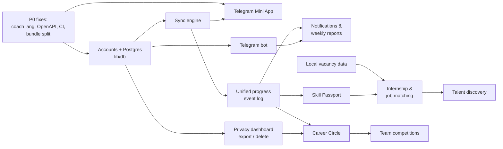

# 7. Product roadmap

This roadmap merges the earlier roadmap from the README (Skill Passport, Talent Matcher, Telegram and PWA, local data,
pilot, regional expansion, partnerships, institution dashboards, mentoring, fairness audit) with the findings of the
22 November 2026 code audit and the Telegram direction in [08-telegram-ecosystem.md](08-telegram-ecosystem.md).
Priorities: **P0** = before anything else, **P1** = next stage, **P2** = after that, **P3** = long term.

## 7.1 Completed (in the code today)

| Area | Delivered |
| --- | --- |
| Learner journey | 6-step onboarding with occupation autocomplete, CV scrubbing and extraction, weekly hours, four career strategies |
| Engine | Deterministic match score, Skill Momentum Index, Wind Rose, Harada roadmap, confirmed skill progression with revert |
| Learning | 23 courses, researched local and online catalogue, own learning paths, accessibility-aware course choice |
| Motivation | 24 badges with reveal and per-badge previews, titles, frames, Wind Rose colours, getting-started guide, reflections |
| Assistant | Deterministic answers and commands in three languages, optional LLM, neural speech with fallbacks, speech input |
| HR | 4-step HR onboarding (fixed), synthetic-team workforce intelligence, AI scenarios, training plan, locked premium previews |
| Data | SIAT, World Bank and Remotive retrieval with honest status; 26-source catalogue; changelog |
| Reach | Uzbek (Latin and Cyrillic), Russian, English; light/dark; accessibility panel; responsive; URL per screen |
| Sharing | Five on-device PDF reports; system share sheet |
| Demo | One-click synthetic learner, demo badge unlock, labelled demo organisation |
| Quality | 200 automated tests, browser e2e script across 4 languages × 2 themes × 2 widths |

## 7.2 Needed now (P0: fixes and foundations)

| # | Item | Why | Effort |
| --- | --- | --- | --- |
| 1 | Fix `/api/coach` language enum (`en, uz, ru`), add Uzbek instruction | AI explanation fails for the default language | XS |
| 2 | Complete the OpenAPI spec (`/tts`, `/assistant`, `POST /fergana/signals`) and regenerate | One contract for clients, including the Telegram bot | S |
| 3 | Add the e2e script and unit tests to CI on every PR | Regressions such as the HR crash reached `main` | S |
| 4 | Add an Institution entry point (path card or menu) or hide the view deliberately | A built feature is invisible | XS |
| 5 | Align server skills with the 50 frontend skills | 10 skills never get live momentum | S |
| 6 | Add TTS variables to `.env.example`; remove or document the unused `lib/db` | Developer clarity | XS |
| 7 | Commit a `vercel.json` (or deployment notes) matching the real hosting | Reproducible deployments; see [05-deployment.md](05-deployment.md) | XS |
| 8 | Native review of Uzbek and Russian copy | Default-language quality | S |
| 9 | Code-split the 2.1 MB bundle (PDF, charts, assistant on demand) | Mobile and low-bandwidth users | M |

## 7.3 Next stage (P1): accounts, sync and Telegram

Accounts are the foundation for everything social or cross-device. Today's "local-first, no account" mode must remain
available.

| Item | Summary | Depends on |
| --- | --- | --- |
| Identity and accounts (optional) | Server-side profile store; anonymous local mode stays the default | PostgreSQL (`lib/db`), auth design |
| Sync engine | Move the persisted store slice to the server with versioned merges; the same engine runs on both sides | Accounts |
| Telegram bot | Commands, reminders, weekly digest, deep links into the Mini App | Accounts, API contract |
| Telegram Mini App | The existing SPA in Telegram's WebView with init-data authentication | Accounts, bundle size |
| Unified progress model | One event log for goals, skills, courses, hours, milestones and badges | Sync engine |
| Notifications service | Opt-in reminders and alerts with quiet hours | Bot, progress model |
| Privacy dashboard | See, export and delete all data | Accounts |

Full design: [08-telegram-ecosystem.md](08-telegram-ecosystem.md).

## 7.4 Planned (P2)

| Item | Summary | Origin |
| --- | --- | --- |
| Career Circle | Opt-in connections, shared goals, learning groups and challenges, mutual-consent comparison | Telegram direction |
| Verified Skill Passport | Shareable summary/PDF of completed Harada goals, Wind Rose and badges with a verification QR code | Earlier README roadmap |
| Local vacancy data | ish.mehnat.uz vacancies (with access), ILOSTAT series, regional breakdowns | Earlier README roadmap |
| Skill assessments | Short practical checks that confirm self-rated levels | Enhancements |
| AI career coach with memory | Consent-based long-term context, grounded in the deterministic engine | Enhancements |
| B2B Talent Matcher | Employers search anonymised, opted-in profiles of learners with specific badges | Earlier README roadmap |
| Pilot | One school, one employment centre and one training provider in Fergana | Earlier README roadmap |

## 7.5 Long-term vision (P3, 6–24 months)

- All 14 regions of Uzbekistan, then Central Asia, with Tajik and Kazakh interfaces.
- Course partnerships (IT Park, universities, online platforms) whose completion data updates skill levels automatically
  (with consent).
- Institution and ministry dashboards: anonymised regional skill-gap maps for training budgets.
- Mentor and peer-learning matching; employer-sponsored learning paths.
- Internship and job matching with consented profiles.
- Independent audit of the scoring formulas for fairness and bias.

**Business model (proposed, unchanged from the README):** free for learners; revenue from employers (talent matching,
team reskilling plans), training providers (verified course placement and referrals) and public-sector licences
(regional analytics), always with anonymised, consented data.

## 7.6 Dependencies and order

Suggested sequence:

| Stage | Scope | Exit criteria |
| --- | --- | --- |
| **Stage 0** (1–2 weeks) | All P0 items | CI green on every PR; Uzbek AI explanation works; spec complete |
| **Stage 1** (4–6 weeks) | Accounts (optional), Postgres schema, sync, privacy dashboard | A learner can sign in, sync two devices, export and delete their data |
| **Stage 2** (4–6 weeks) | Telegram bot + Mini App + notifications | Bot linked to an account; Mini App opens the dashboard; opt-in weekly digest |
| **Stage 3** (6–8 weeks) | Unified progress timeline, Career Circle (1:1 and groups), Skill Passport | Mutual-consent sharing works and can be revoked; passport verifies |
| **Stage 4** (ongoing) | Local vacancies, assessments, AI coach memory, B2B features, regional expansion | Driven by pilot feedback |

## 7.7 Technical dependencies

| Dependency | Needed for | Notes |
| --- | --- | --- |
| PostgreSQL (Drizzle via `lib/db`) | Accounts, sync, social, notifications | The scaffold already exists; add migrations |
| Durable cache / KV (for example Redis) | Rate limits, refresh cooldowns, bot state across instances | Replaces in-memory maps |
| Telegram Bot API and Mini App SDK | Bot, Mini App, login | Requires a bot token from @BotFather and HTTPS webhooks |
| Job scheduler | Digests, reminders, signal refresh | Existing `/api/signals/cron` pattern can be generalised |
| RunPod or another LLM host | Coach, CV, assistant | Keep deterministic fallbacks |
| Speech providers | Voice | Edge voices are free but unofficial; budget for a paid provider at scale |
| Data-protection review | Accounts, Telegram, location | Uzbekistan's Law "On Personal Data" (ZRU-547, 2019) governs consent and processing. Amendments signed 26 March 2026 (Law No. 1125) narrowed mandatory in-country storage to biometric and genetic data and telecom-subscriber data, and a July 2026 resolution lists 49 countries for simplified transfers. Re-check the current rules and the hosting country with counsel before launch (see [08-telegram-ecosystem.md](08-telegram-ecosystem.md#13-legal-and-compliance-notes)) |
