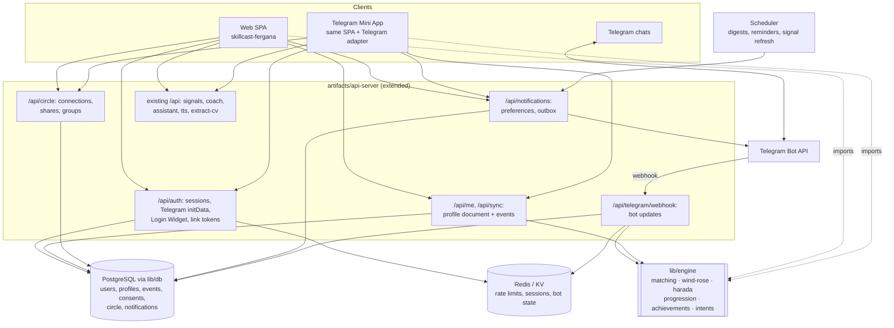
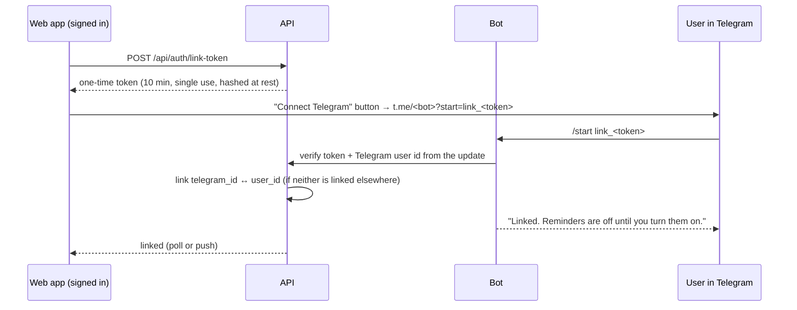
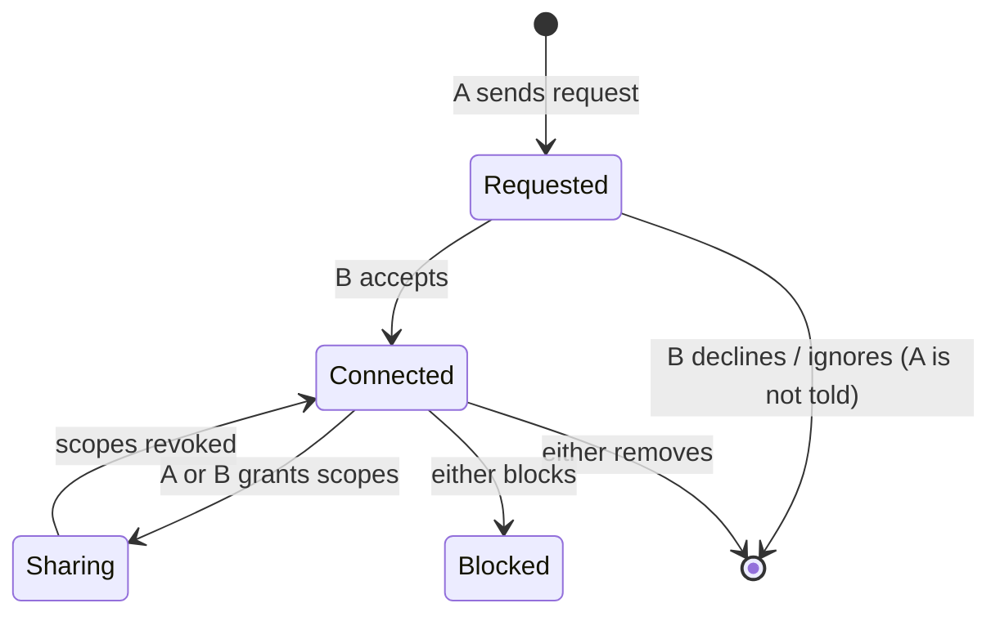

# 8. Telegram ecosystem: proposed next stage

> **Status: 📋 Planned. Nothing in this document is implemented.** It is a design for the next development stages,
> written against the current code so that it can be built incrementally. Where it says "reuse", the named file exists
> today.

## 1. Why Telegram

Telegram is where most people in Uzbekistan already message, read news and follow channels. A learner who has to
remember to open a website will drift away; a learner who gets "This week: 2 Harada tasks left for Data Analysis — open
your plan" in a chat they already read is more likely to keep going. The goal is to turn SkillCast from a standalone web
app into a **career-intelligence companion that reaches people where they are**, without building a second product.

### Goals

1. One SkillCast account, usable on the web and in Telegram, with the same profile, plan and progress.
2. A **Telegram Mini App** that is the existing SkillCast SPA, adapted, not rewritten.
3. A **bot** for quick answers, reminders, weekly digests and deep links into the Mini App.
4. Opt-in **notifications** about learning tasks, achievements, emerging skills and opportunities.
5. Opt-in social accountability through **Career Circle**.
6. A **unified progress model** that the web app, Mini App, bot and Career Circle all read from.

### Non-goals

- No covert tracking, no IP-based profiling, no selling of data.
- No replacement of the anonymous, local-first web mode: signing in stays optional.
- No separate business logic for Telegram: scores, gaps and plans come from the same deterministic engine.

## 2. Design principles

| Principle | Consequence |
| --- | --- |
| **Reuse the engine** | Move the pure functions in `artifacts/skillcast-fergana/src/lib/` (`matching.ts`, `wind-rose.ts`, `harada.ts`, `progression.ts`, `achievements.ts`, `voice-intents.ts`) and `src/data/` into a shared workspace package (proposed `lib/engine`), imported by the SPA, the API and the bot. They are already dependency-light and unit-tested. |
| **Reuse the API** | Extend `artifacts/api-server` with new routers (`auth`, `me`, `sync`, `telegram`, `circle`, `notifications`) instead of a new service. |
| **Reuse the SPA** | The Mini App is the same build with a Telegram adapter; screens are opened by the existing hash routes (`#/forecast/radar`), see `route-sync.tsx`. |
| **Local-first stays** | Without an account, everything works as today. Signing in uploads the local profile only after explicit consent. |
| **Consent per purpose** | Accounts, notifications, Career Circle sharing and analytics are separate, revocable consents. |
| **Minimum data** | Store Telegram's numeric user id and the user's chosen display name; do not store phone numbers, contacts, IP addresses or precise location. |
| **Deterministic first** | Bot answers come from the deterministic assistant; the LLM is optional, as today. |

## 3. Target architecture



**Bot framework**: [grammY](https://grammy.dev) (TypeScript, webhook-friendly) or Telegraf. Run it inside the API
process behind `POST /api/telegram/webhook` with Telegram's secret-token header check, so there is one deployable.

## 4. Identity, accounts and Telegram linking

### 4.1 Account model

An account is created only when a user chooses to sign in. Sign-in methods:

| Method | Where | Verification |
| --- | --- | --- |
| Telegram Mini App | Inside Telegram | Validate `initData` on the server (below) |
| Telegram Login Widget | Web | Validate the widget payload: HMAC-SHA256 with `SHA256(bot_token)` as key; check `auth_date` |
| Email magic link (optional) | Web | One-time token, 15-minute expiry |

### 4.2 Validating Mini App `initData` (server side)

The Mini App sends `Telegram.WebApp.initData` (the raw query string, **never** `initDataUnsafe`) to
`POST /api/auth/telegram`. The server follows Telegram's documented algorithm
([core.telegram.org/bots/webapps — Validating data received via the Mini App](https://core.telegram.org/bots/webapps#validating-data-received-via-the-mini-app)):

```ts
// Proposed: artifacts/api-server/src/routes/auth.ts (not implemented)
import { createHmac, timingSafeEqual } from 'node:crypto';

export function verifyInitData(initData: string, botToken: string, maxAgeSec = 3600) {
  const params = new URLSearchParams(initData);
  const hash = params.get('hash');
  if (!hash) return null;
  params.delete('hash');
  const dataCheckString = [...params.entries()]
    .sort(([a], [b]) => a.localeCompare(b))
    .map(([k, v]) => `${k}=${v}`)
    .join('\n');
  const secret = createHmac('sha256', 'WebAppData').update(botToken).digest();
  const expected = createHmac('sha256', secret).update(dataCheckString).digest();
  const given = Buffer.from(hash, 'hex');
  if (given.length !== expected.length || !timingSafeEqual(given, expected)) return null;
  const authDate = Number(params.get('auth_date'));
  if (!Number.isFinite(authDate) || Date.now() / 1000 - authDate > maxAgeSec) return null; // stale: re-open the app
  return JSON.parse(params.get('user') ?? 'null') as { id: number; first_name?: string; language_code?: string } | null;
}
```

Rules: constant-time comparison; reject stale `auth_date`; never trust user data before validation; never log the raw
`initData`; keep the bot token only in server secrets. On success the server issues a short-lived session (for example a
15-minute access token kept in memory in the Mini App, refreshed with a rotating refresh token), because cookies inside
Telegram's WebView are unreliable across platforms. The web app uses an `HttpOnly; Secure; SameSite=Lax` cookie.

### 4.3 Linking a web account and a Telegram account



The reverse direction (start in Telegram, continue on the web) uses the Login Widget, or a short code shown in the bot
and entered on the web. Unlinking is available on both sides and deletes the link and any Telegram-only notification
settings. A Telegram account can be linked to one SkillCast account at a time.

### 4.4 Bringing existing local data into an account

On first sign-in, if the browser holds a local profile (`localStorage` `skillcast-poc`), the app shows exactly what will be
uploaded (profile, skills, plan, progress, badges; **not** demo data, which is detected by `demoMode` and excluded) and
asks for consent. If the server already has a profile, the user chooses which one to keep; nothing is merged silently.

## 5. Data model (PostgreSQL via `lib/db`)

```sql
-- Proposed schema (Drizzle). Not implemented.
users              (id uuid pk, created_at, display_name text null, lang text, deleted_at null)
auth_identities    (id, user_id fk, provider text check (provider in ('telegram','email')),
                    subject text,               -- Telegram numeric id or email hash
                    created_at, unique(provider, subject))
consents           (id, user_id, purpose text,  -- 'account','sync','notifications','circle','analytics'
                    granted_at, revoked_at null, version text)
profiles           (user_id pk, doc jsonb,      -- the persisted store slice, validated by normalizeProfile()
                    version int, updated_at)
progress_events    (id, user_id, type text, payload jsonb, occurred_at, source text, idempotency_key unique)
notification_prefs (user_id pk, channel text, digest text, reminders bool, quiet_from time, quiet_to time,
                    tz text default 'Asia/Tashkent', paused_until null)
notification_outbox(id, user_id, kind, payload jsonb, scheduled_for, sent_at null, error null)
circle_connections (id, requester_id, addressee_id, status text, created_at, responded_at,
                    unique(least(requester_id,addressee_id), greatest(...)))
circle_shares      (owner_id, viewer_id, scope text, granted_at, revoked_at null)  -- per-connection scopes
circle_groups      (id, owner_id, name, created_at) ; circle_members(group_id, user_id, role, joined_at)
circle_challenges  (id, group_id, kind, target jsonb, starts_at, ends_at)
audit_log          (id, user_id, action, at)    -- security-relevant actions only; no content
```

Retention: delete on account deletion within 30 days (immediately from primary tables, then from backups on rotation).
Server logs keep no request bodies and no raw IP addresses (section 7).

## 6. Sync between the web app and Telegram

- The **profile document** is today's persisted store slice (`partialize` in `src/lib/store.ts`), validated on the server
  by the same `normalizeProfile` and `merge` rules.
- Changes are sent as **events** (course completed, level-up confirmed, Harada task status, reflection saved, badge
  earned) with an idempotency key, plus a versioned document snapshot.
- Conflicts: events are a union (idempotent); the document uses per-field last-writer-wins with the version number, and
  the client re-derives badges and readiness with the engine, so derived values never conflict.
- Offline: the SPA keeps working from `localStorage` and replays queued events when back online.
- Badges are re-evaluated on the server from events with the same `eligibleBadges` rules, so they cannot be forged by
  editing local storage once accounts exist.

## 7. User location and IP information: assessment

### 7.1 Is IP-based location needed?

**Recommendation: no, not for recommendations.** SkillCast already asks for country and city in onboarding
(`profile.extended.country` / `city`) and has an explicit in-person/online preference. A user's own choice is more
accurate and more respectful than an IP lookup:

| Problem with IP geolocation | Effect in Uzbekistan |
| --- | --- |
| Mobile carriers route through a few gateways (often Tashkent) | A learner in Fergana would be placed in the capital |
| VPNs and proxies are widely used | Wrong country entirely |
| Shared networks (colleges, offices, internet cafés) | Many people share one address |
| Database errors at city level | City-level accuracy is often poor outside capitals |
| Users who moved for work or study | Network location ≠ the labour market they care about |

Telegram's `initData` contains no IP address or location, and a Mini App can only read device location after an
explicit Telegram permission prompt; SkillCast does not need it. Like any web server, though, the SkillCast API does
see the network address of each request. That is why the safeguards below govern how such addresses are handled.

### 7.2 What SkillCast will do instead

1. **User-selected region** remains the source of truth for local resources, regional signals and Career Circle groups.
2. **Optional, transient language/region hint** on a first web visit: the server may map the request to a *country*
   in memory to pre-select a language or suggest "Are you in Uzbekistan?", **without storing the IP or the result**.
   The user confirms or changes it. This is off unless the privacy notice describes it.
3. **Regional analytics** come only from user-declared regions of consenting users, aggregated with a minimum group size
   (for example, no figure shown for fewer than 20 learners) so that no individual can be singled out.

### 7.3 Safeguards (binding for any future feature that touches network data)

- Never collect IP addresses secretly or use them for tracking, profiling or advertising.
- Never store raw IPs in the database. Rate limiting keeps per-IP counters in memory or Redis for at most minutes, keyed
  by a salted hash with a daily rotating salt.
- Request logs: no IP (today's Pino serializer already omits it; keep it that way), no bodies, 14-day retention.
- Explain in the privacy notice what is processed, why, for how long, and the legal basis.
- Never expose one user's IP, location or private data to another user, including in Career Circle.
- Provide privacy controls: change region, clear location-derived suggestions, export and delete all data.

## 8. Career Circle (opt-in professional network)

**Purpose: accountability, motivation and collaborative learning, not surveillance.** Everything is off by default.

### 8.1 Features

| Feature | Behaviour |
| --- | --- |
| Connections | Add by username or invite link / QR (no phone-contact upload). Requests can be accepted, declined or ignored; declining is silent. |
| Private catalogue | A personal list of connections with private notes and tags ("study partner", "mentor"), visible only to the owner. |
| Share scopes | Per connection, choose exactly what they see: career goal, target role, Wind Rose (levels only), weekly hours, course completions, badges, Harada milestones. Default: nothing. |
| Encouragement | Reactions and short "kudos" on milestones and badges; a weekly "your circle this week" summary. |
| Learning groups | Small groups (for example up to 20) around a goal or course; shared group goals and progress. |
| Shared challenges | Time-boxed challenges ("10 study hours in 2 weeks", "finish the Kaggle Pandas course"), progress from events. |
| Comparison | Side-by-side progress **only when both people have opted in to compare with each other**; either can stop at any time. |
| Control | Remove a connection, revoke a scope, leave a group, block and report. Revocation takes effect immediately. |

### 8.2 Consent and safety rules

- Two-sided consent for comparisons; one-sided sharing is always "I share with you", never "I can see you".
- No public profiles, no search by phone number, no "people you may know" from contacts or location.
- Rate-limit connection requests; block stops all requests and hides both sides from each other.
- Employers cannot see Career Circle data. Talent discovery ([09-future-enhancements.md](09-future-enhancements.md#17-employer-recruitment-and-talent-discovery), #17) is a separate, explicit opt-in.
- Minors: require a minimum age (for example 16) for Career Circle, or institution-managed groups with guardian consent.
- Moderation for group names and kudos text (report and remove).

### 8.3 Flow



## 9. Unified career progress tracking

### 9.1 What is tracked (all exists in some form today)

| Dimension | Today (browser store) | Unified event |
| --- | --- | --- |
| Career goals | `chosenRole`, `profile.objective` | `goal.set`, `goal.changed` |
| Current skills and levels | `profile.skills` | `skill.rated`, `skill.levelup.confirmed` (from `skillUpdates`) |
| Skills being developed | Wind Rose priorities, Harada areas | derived |
| Completed courses | `completedCourses` | `course.completed`, `course.uncompleted` |
| Learning hours | `profile.weeklyHoursCompleted`, Harada task hours | `hours.logged` |
| Weekly milestones | Harada task statuses, `completedRoadmapTasks` | `harada.task.status`, `harada.milestone` |
| Achievements and badges | `badges`, `badgesSeen` | `badge.earned` (server-verified) |
| Progress to future roles | `matchAll().skillReadiness` | derived per role, snapshotted weekly |
| Personal and group progress | `activeDays`, reflections | `study.day`, `reflection.saved`; group progress = sum over members with consent |

### 9.2 Views

- **Timeline**: a chronological feed of events with filters (courses, skills, badges, milestones).
- **Weekly view**: hours vs plan, tasks done, readiness change, next three tasks; the same content as the Telegram digest.
- **Role progress**: readiness history per target role (sparkline) and the gaps that closed.
- **Group view**: group goal progress, recent kudos, challenge standings (only consenting members).

### 9.3 Notifications and reminders (opt-in)

| Notification | Default | Trigger | Example (EN) |
| --- | --- | --- | --- |
| Weekly digest | off | Sunday 18:00 local time | "Week 3: 4.5 h of 6 h, 2 Harada tasks done. Next: 'Practice the core technique' for Data Analysis." |
| Task reminder | off | User-chosen days and time | "15 minutes today? Your next step is ready." |
| Achievement | on once accounts are enabled | `badge.earned` | "New treasure: Rishtan blue bowl (Skill Builder, Bronze)!" |
| Emerging skill | off | Momentum of a skill on the learner's map rises by ≥ 10 points | "Prompt & GenAI Orchestration is rising in the latest signals." |
| Opportunity | off, Stage 4 | A new course, place or vacancy matching a top gap | "A free Data Analysis course starts at IT Park Fergana." |
| Circle | off | A connection's shared milestone; challenge start/end | "Dilnoza finished her pathway. Send kudos?" |

Rules: quiet hours (default 22:00–08:00 Asia/Tashkent), at most one non-urgent message a day, one-tap "pause for a week"
and `/stop`, every message in the learner's language (4 languages), and respect for Telegram Bot API limits through a
queue (`notification_outbox`). Opportunity and emerging-skill notices always link to their source.

## 10. The bot

### 10.1 Commands

| Command | What it does | Engine reuse |
| --- | --- | --- |
| `/start` | Welcome, language choice, "Open SkillCast" button; handles `start=link_<token>` | — |
| `/plan` | Target role, readiness, top 3 gaps, next course | `matchAll`, `rolePathway` |
| `/next` | The single next step | assistant `next-learning` intent |
| `/rose` | Text Wind Rose explanation and a button to open the chart | `explainWindRose` |
| `/progress` | Hours, courses, milestones, badges | progress model |
| `/week` | This week's plan | Harada + hours |
| `/badges` | Earned badges and the closest locked one | `badgeProgress` |
| `/remind` | Set reminder days and time | notifications |
| `/circle` | Pending requests, group updates | Career Circle |
| `/lang` | Uzbek (Latin/Cyrillic), Russian, English | i18n dictionaries |
| `/privacy` | What is stored; export; delete; unlink | privacy service |
| `/stop` | Stop all notifications | notifications |
| `/help` | Commands and examples | — |

Free text goes to the deterministic assistant (`parseIntent` in `src/lib/voice-intents.ts`), and to the LLM only if
configured, exactly as in the web assistant. Voice messages can be transcribed later; that is not part of Stage 2.

### 10.2 Deep links into the Mini App

`https://t.me/<bot>/app?startapp=<route>` opens the Mini App; the adapter maps `startapp` to the existing hash routes:
`radar` → `#/forecast/radar`, `harada` → `#/forecast/harada`, `badges` → opens the collection, `employer` → `#/employer`.

## 11. The Mini App (adapting the existing SPA)

| Concern | Approach |
| --- | --- |
| Loading | Add `telegram-web-app.js` only when launched inside Telegram; update the production CSP (`script-src` and `connect-src`) accordingly |
| Auth | On launch, send `initData` to `/api/auth/telegram`; keep the session in memory |
| Theme | Map Telegram `colorScheme` / `themeParams` to SkillCast light/dark (the theme switch already exists) |
| Navigation | Telegram BackButton ↔ browser history; `route-sync.tsx` already makes Back work between screens |
| Main button | Use Telegram's MainButton for the primary action of a screen (for example "Continue" in onboarding) |
| Viewport | Respect safe areas and the expandable viewport; the layouts already work at 360–390 px |
| Performance | Code-split the 2.1 MB bundle first (Stage 0); the Mini App must open quickly on mobile data |
| Features to hide or adapt | System share sheet → Telegram share; PDF download → send the PDF to the chat via the bot |

## 12. Security and privacy checklist

- [ ] Bot token, session secrets and DB credentials only in server secrets; rotated if leaked.
- [ ] Webhook protected by Telegram's `X-Telegram-Bot-Api-Secret-Token`; reject other callers.
- [ ] `initData` and Login Widget payloads validated server-side, with freshness checks and constant-time comparison.
- [ ] Sessions short-lived and revocable; refresh tokens rotated; logout everywhere.
- [ ] CORS restricted to the web origin and Telegram's WebView origin; CSRF protection for cookie sessions.
- [ ] Authorization on every Career Circle read: the viewer must hold an active share scope from the owner.
- [ ] Rate limits in a shared store; abuse limits on connection requests and messages.
- [ ] No raw IPs, request bodies or `initData` in logs; 14-day log retention.
- [ ] Privacy dashboard: view, export (JSON), delete account, unlink Telegram, withdraw each consent.
- [ ] Data-protection impact assessment before launch; privacy notice in four languages.

## 13. Legal and compliance notes

These are planning notes, not legal advice; confirm with counsel before launch.

- **Uzbekistan**: the Law "On Personal Data" (ZRU-547, 2 July 2019) requires a lawful basis (typically consent),
  purpose limitation and data-subject rights. Amendments signed on 26 March 2026 (Law No. 1125) narrowed the earlier
  blanket in-country storage rule (Article 27-1) to biometric and genetic data and to subscriber data of telecom
  operators; a resolution of 29 July 2026 approved 49 countries for simplified transfers. Check the current text on
  lex.uz and choose hosting accordingly.
  ([Daryo, 29 Mar 2026](https://daryo.uz/en/2026/03/29/uzbekistan-amends-personal-data-law-for-domestic-storage-and-regulated-foreign-processing/),
  [Kun.uz, 4 Aug 2026](https://kun.uz/en/news/2026/08/04/uzbekistan-approves-49-countries-for-simplified-personal-data-transfers))
- **Other users**: if learners outside Uzbekistan sign up (for example in the EU), GDPR obligations apply.
- **Telegram**: follow the Telegram Bot Platform terms and the Mini App guidelines; do not message users who have not
  started the bot.
- **Minors**: decide a minimum age, and an institution-managed path for younger students.

## 14. Implementation plan

| Phase | Deliverables | Depends on | Size |
| --- | --- | --- | --- |
| T0 | `lib/engine` extracted from the SPA (no behaviour change, tests moved along) | — | M |
| T1 | Postgres schema + migrations in `lib/db`; `/api/auth` (Telegram + Login Widget), sessions, `/api/me`, consents | T0 | L |
| T2 | Sync: profile document + events, local-data import with consent, privacy dashboard (export/delete) | T1 | L |
| T3 | Bot: webhook, `/start`, link flow, `/plan`, `/next`, `/rose`, `/progress`, `/lang`, `/privacy`, `/stop` | T1 | M |
| T4 | Mini App adapter: init, auth, theme, BackButton, deep links; CSP update; bundle split | T1, Stage 0 | M |
| T5 | Notifications: preferences, outbox, scheduler, weekly digest, reminders, achievements | T2, T3 | M |
| T6 | Unified progress timeline and weekly views (web + Mini App) | T2 | M |
| T7 | Career Circle: connections, scopes, kudos; then groups and challenges | T2, T6 | L |

**Testing**: unit tests for `verifyInitData` (valid, tampered, stale, wrong token), contract tests for every new route,
bot conversation tests with a mocked Bot API, e2e in a desktop browser with a simulated Telegram environment, and manual
checks in Telegram on Android, iOS and desktop.

## 15. Open questions

1. Which hosting region for the database, given the 2026 amendments?
2. Minimum age for accounts and Career Circle; institution-managed accounts for students?
3. Should the bot be a single bot for learners and employers, or two?
4. Which notifications should be on by default after sign-in (proposal: achievements only)?
5. Do we need email sign-in at launch, or is Telegram sufficient for the pilot?
